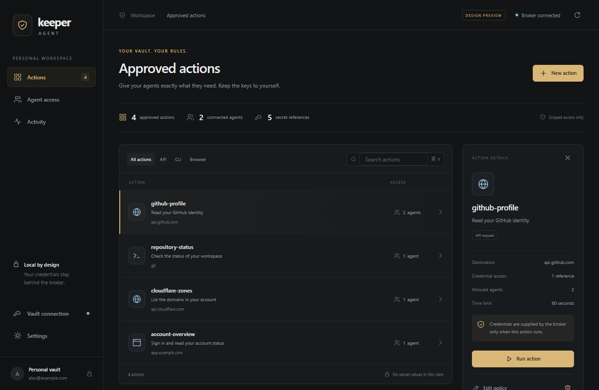

# Keeper Agent desktop

The native administrator app uses dark charcoal and gold by default, with light and system appearance options. Its action list, policy editor, scoped agent grants, activity log, and connection setup all use the same broker as the CLI.



## First use

1. Run the app under the private broker OS account. Agents should use a separate unprivileged account with only their client file.
2. Choose **Vault connection**, enter your Keeper email and region, and create a workspace. Alternatively, select an existing broker folder.
3. Open the private login terminal. Enter your password, MFA, and any device approval there, then refresh the app. The desktop never collects your master password.
4. Create approved actions using record UIDs and field references. Use the advanced policy editor for custom headers, selected output fields, TOTP, or multi-step workflows.
5. For browser workflows, choose **Settings → Install browser** once. This opens a terminal that installs the matching Playwright Chromium in the broker account's cache. Wait for it to finish. Browser downloads are separate from the installer.
6. Grant each agent specific actions. Transfer only its generated client file privately to that agent account. Tokens are not displayed by the UI.

Changes to policy require restarting the terminal broker. Client grants and revocations apply to subsequent requests immediately. Use Ctrl+C in the terminal to disconnect. Closing the administrator window does not stop a separately running broker. Action execution always requires an explicit confirmation.

The simple API form returns status only. Commands suppress output by default. Browser forms wait for a configured success element; selectors and MFA behavior must match your site.

## Architecture and trust

Tauri 2 hosts Svelte 5 in the platform webview (WebView2 on Windows, WKWebView on macOS). Local, bundled assets use system fonts. No Electron runtime, analytics, remote fonts, polling loop, or automatic action retries are included.

The frontend calls a small allowlist of Rust IPC commands. Rust selects the private state path and serializes requests to a Python helper over bounded stdio. There is no administrator HTTP server. The helper uses the existing CLI policy validation, private-file routines, and pinned loopback HTTPS client. Packaging includes Python and dependencies in an on-directory helper, avoiding extraction each time it is launched.

The action overview returns metadata, not record UIDs or tokens. The **policy editor is an administrator view**: it shows the full saved policy, including any literals manually entered outside the GUI. Use Keeper references throughout; common literal credential headers/environment variables are rejected when saving through the GUI, but this is not a general secret detector. Action results retain the broker's documented limits and best-effort redaction.

Desktop run grants are scoped to one action, expire after six minutes, and are revoked/deleted in a finally block. If the process is forcibly killed, an expired temporary grant/file can remain inside private state; its bearer token no longer authenticates after expiry. Use one administrator instance and avoid editing state simultaneously through the CLI.

Keeper authentication remains vault-wide inside Commander. OS account separation remains the security boundary; the GUI does not sandbox arbitrary approved executables. See the root README for the complete threat model.

## Development

Install Python 3.12, Node 22.12+ or 24, Rust, and the platform's [Tauri prerequisites](https://v2.tauri.app/start/prerequisites/). From the repository root:

```powershell
py -3.12 -m venv .venv
.venv/Scripts/python.exe -m pip install -e ".[keeper,browser,test]" -c constraints-windows-py312.txt
.venv/Scripts/python.exe -m pip install pyinstaller==6.22.3
cd desktop
npm ci
npm run desktop
```

On macOS use `python3.12 -m venv .venv` and `.venv/bin/python`; install `-e '.[keeper,browser,test]'` without the Windows environment constraint file. The development shell uses only the repository's `.venv`, never a Python executable found on PATH.

`npm run dev` opens a browser-only preview. It starts empty; append `?demo=1` for clearly labelled synthetic fixtures. Neither preview mode connects to a vault. Native builds always use the real bridge and never demo fixtures.

## Packaging

From the repository root, with the development environment installed:

```powershell
.venv/Scripts/python.exe desktop/scripts/package_core.py
cd desktop
npm run desktop:build -- --bundles nsis
```

Windows output is under `desktop/src-tauri/target/release/bundle/nsis/`. Keep the `core` resources with the native executable; the executable alone is not a portable distribution.

On a Mac, build the helper with `.venv/bin/python desktop/scripts/package_core.py`, then `npm run desktop:build -- --bundles app,dmg`. Build natively for the desired architecture so Python, its compiled dependencies, and Rust all match. A universal Rust executable alone does not make the Python helper universal.

The manual GitHub Actions workflow builds Windows and the available macOS runner architecture, tests the frontend and backend, smoke-tests the frozen helper, and uploads private CI artifacts. It does not publish a release or use your vault. The first verified macOS artifact targets Apple Silicon (ARM64). Interactive macOS behavior, signing, and notarization still need validation before distribution. Both packages are unsigned development builds. See [the build results](../VALIDATION.md) for measured sizes, tests, and limitations.

References: [Tauri distribution](https://v2.tauri.app/distribute/), [resource embedding](https://v2.tauri.app/develop/resources/), and [Playwright browser installation](https://playwright.dev/python/docs/browsers).

## Verification

Backend tests use synthetic credentials. UI tests cover empty onboarding, search, confirmation/results, action creation, grants/revocation, keyboard dismissal, appearance, and the minimum window size. They run against the browser preview, not a live Keeper account.

```powershell
# From the repository root:
.venv/Scripts/python.exe -m pytest -q
# From desktop:
npx playwright install chromium --only-shell
npm test
npm run build
```

Generated screenshots are kept in `docs/images`. Build environments, browser caches, sidecars, logs, and test scratch data are ignored. Measurements and platform validation limits are recorded in `VALIDATION.md`.
